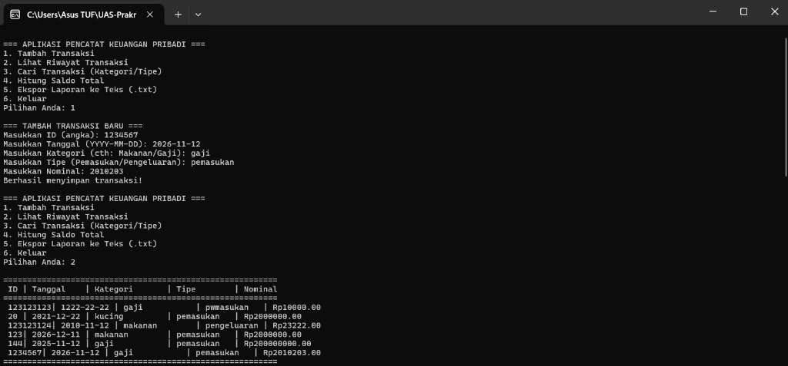
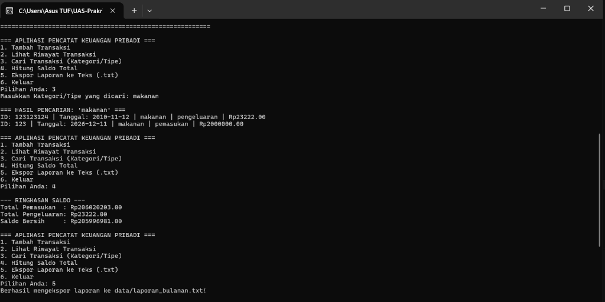

Proyek UAS Praktikum Pemrograman - Aplikasi Catatan Keuangan

Proyek ini dibuat untuk tugas akhir UAS Praktikum Pemrograman Komputer (Kelas B - Kelompok 7). Aplikasi ini adalah program pencatat keuangan sederhana berbasis terminal (CLI) menggunakan bahasa C, dengan penyimpanan data ke file binary dan fitur ekspor ke file teks.

Anggota Kelompok 7
1. Ahmad Faiz Nuzuli - 260810701100042
2. Diva Alifia - 260810701100030
3. Mujiburrahman - 260810701100087
4. Ghailan Anaqi - 260810701100109
5. Muhammad Raditya Akbar - 260810701100063

Fitur Program
- Tambah Transaksi: mencatat transaksi baru pemasukan atau pengeluaran secara manual lewat menu interaktif.
- Lihat Riwayat: menampilkan daftar transaksi yang tersimpan di file binary (data/keuangan.bin).
- Cari Transaksi: mencari catatan berdasarkan kategori atau tipe (pemasukan/pengeluaran).
- Hitung Saldo: menghitung total pemasukan, total pengeluaran, dan sisa saldo.
- Ekspor Laporan: menyimpan riwayat transaksi ke file teks (data/laporan_bulanan.txt).
- Perintah CLI Cepat: menjalankan fungsi langsung lewat terminal menggunakan argumen --tambah, --cari, dan --help.

Struktur Struct yang Digunakan
Data transaksi dibungkus dalam struct CatatanKeuangan:

typedef struct {
    int id;
    char tanggal[15];
    char kategori[30];
    char tipe[15];
    double nominal;
} CatatanKeuangan;

Cara Kompilasi dan Menjalankan Program

1. Kompilasi (Compile)

gcc src/main.c src/fitur.c -Iinclude -o program.exe

2. Cara Menjalankan Program
Mode interaktif:
./program.exe

Mode argumen CLI:
- Melihat bantuan:
./program.exe --help

- Cari transaksi:
./program.exe --cari <kategori/tipe>

- Tambah cepat:
./program.exe --tambah <YYYY-MM-DD> <Kategori> <Tipe> <Nominal>

Contoh Output Program

1. Tambah Transaksi dan Lihat Riwayat

2. Cari Transaksi, Hitung Saldo, dan Ekspor Laporan

